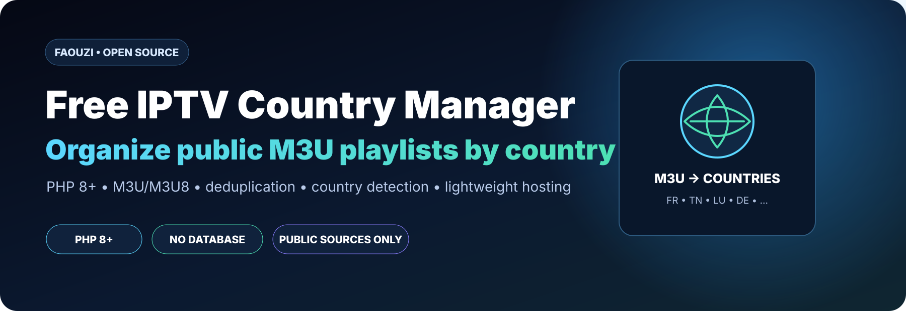

# Free IPTV Country Manager



**A lightweight PHP tool that organizes public and authorized M3U/M3U8 playlists by country.**

> Built for simple hosting environments such as Apache/Hostinger. No database required.

## ✨ What it does

- Imports a public `.m3u` / `.m3u8` playlist or playlist URL.
- Detects the country using `tvg-country`, then falls back to `group-title` and channel name.
- Removes duplicate channels.
- Generates one playlist per country.
- Sends unidentified channels to `zz.m3u` for review.
- Runs on **PHP 8+** with no database.

## 🚀 Quick start

1. Deploy the repository on a PHP 8+ server.
2. Open `index.php`.
3. Upload an authorized `.m3u/.m3u8` file or enter a playlist URL.
4. Let the importer classify and deduplicate the channels.
5. Retrieve the generated playlists from `countries/`.

## 🧭 Output example

```text
countries/
├── fr.m3u
├── tn.m3u
├── lu.m3u
├── de.m3u
└── zz.m3u
```

## 🧩 Project structure

```text
/
├── index.php
├── import.php
├── api.php
├── lib/
│   └── playlist.php
├── countries/
├── data/
├── sources.txt
└── .htaccess
```

## 🌍 Public example source

[TDTChannels](https://www.tdtchannels.com/) publishes official public channel lists, including:

- `https://www.tdtchannels.com/lists/tv.m3u8`
- `https://www.tdtchannels.com/lists/tv.m3u`

Availability may change and some streams may be geoblocked.

## ⚖️ Responsible use

This project does **not** grant rights to audiovisual content. Use only playlists and streams that you are legally allowed to access, integrate, process or redistribute.

“Free to watch” does not automatically mean “free to redistribute.”

## 🛠️ Tech

`PHP 8+` · `M3U/M3U8` · `Apache` · `No database`

---

### More projects

Explore my AI and automation work in **[N8N Market AI / Faouzi AI Lab](https://github.com/faouzileif02/workflow-store)**.
